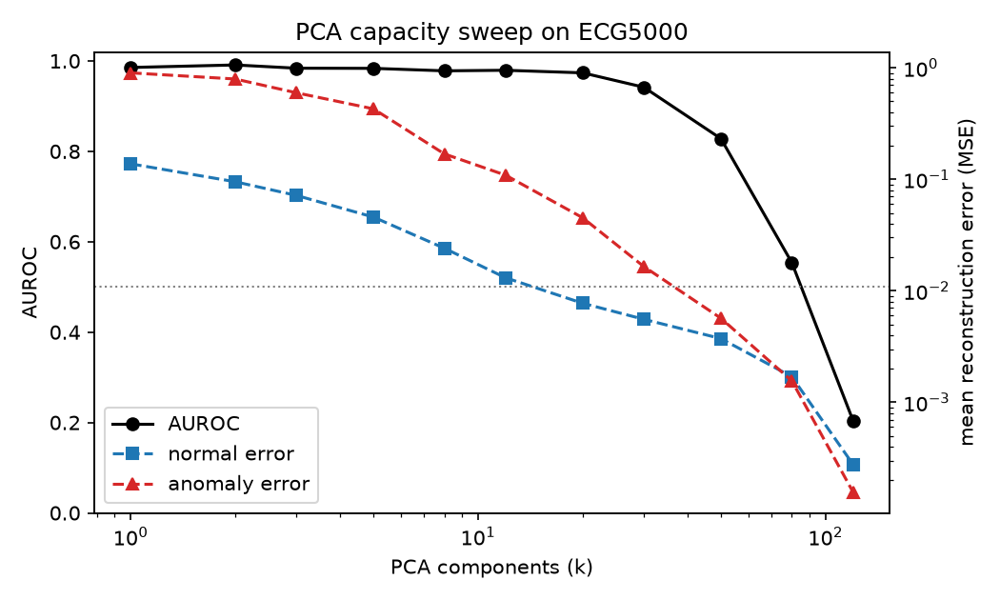
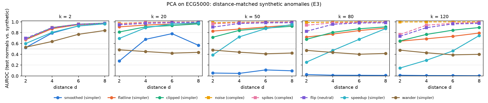
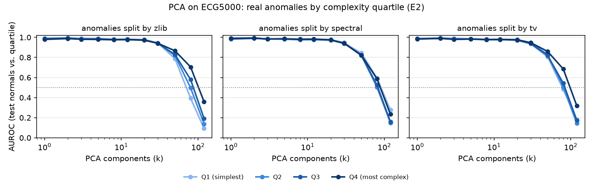
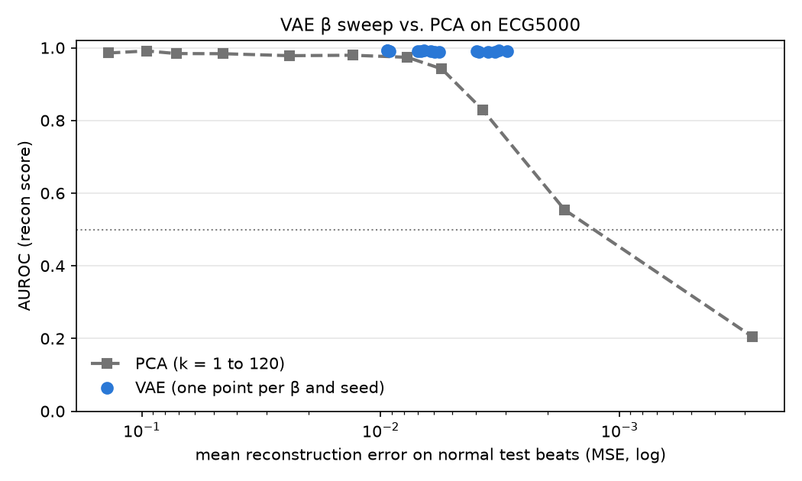
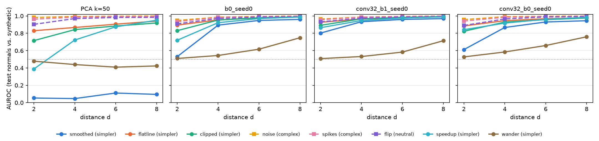

# When Reconstruction Gets Too Good

**When and why does reconstruction-based anomaly detection fail in generative models?**

A model trained only on normal data is supposed to reconstruct anomalies badly.
But as capacity grows, a model can learn to reconstruct *everything*, anomalies
included, and detection collapses — sometimes below chance. This project is a
controlled study of that failure on ECG heartbeats, comparing a linear
baseline (PCA), a VAE and a diffusion model, and asking whether what makes a
model *generative* (a KL prior, a noise schedule, a likelihood score) protects
detection as capacity grows.

## Research questions

- **RQ1 – Capacity:** How does detection (AUROC) change as model capacity grows?
- **RQ2 – Scores:** Do reconstruction error, KL and likelihood (ELBO) agree on
  which samples are anomalous?
- **RQ3 – Why it fails:** Is failure driven by capacity, or by anomalies being
  *simpler* than normal data? Tested with synthetic anomalies matched on
  distance from normal.
- **RQ4 – Label-free selection:** Without labeled anomalies, can we pick a
  capacity that detects well, using AUROC on synthetic anomalies as a proxy?

The full plan is in [PLAN.md](PLAN.md).

## Data

- **ECG5000** (primary): 5,000 heartbeats of 140 points. Class 1 = normal,
  classes 2–5 = abnormal beat types. Beats are already z-normalized per beat by
  UCR. Normal beats are split 70/15/15 (train / val / test); all anomalies go
  to test. Models are trained on normal beats only.
  Because of the per-beat normalization, the study is about *shape*-based
  simplicity (smoothing, speedup), not amplitude.
- **Second dataset** (to be decided): MVTec AD (2D images, where autoencoders
  are known to reconstruct anomalies too well) or MIT-BIH (raw-amplitude ECG).

## Experiments

| | Anomalies | Purpose |
|---|---|---|
| **E1** | real anomaly classes | capacity sweeps (RQ1, RQ2) |
| **E2** | real classes, split by measured complexity | are the *simpler* real anomalies the ones missed? (RQ3) |
| **E3** | synthetic, distance-matched (8 types, below) | RQ3, controlled |
| **E4** | synthetic anomalies built from validation normals | label-free capacity selection (RQ4) |

E3 anomaly types (`src/ecg/anomalies.py`), each tuned per beat to a distance
d ∈ {2, 4, 6, 8} from the source beat and renormalized to its mean and std:

| Type | What it does | Direction |
|---|---|---|
| smoothed | Gaussian low-pass filter | simpler |
| flatline | a segment set to its mean | simpler |
| clipped | main peak clipped | simpler |
| speedup | beat squeezed in time around its main peak | simpler |
| wander | linear baseline drift | simpler |
| flip | central part of the beat reversed in time | neutral |
| noise | additive Gaussian noise | more complex |
| spikes | three narrow pulses | more complex |

flip, speedup and wander follow Goswami et al. (ICLR 2023), who inject each
anomaly over whole cycles; one beat is one cycle here. Their scale and
contextual (a·x + b) types are left out because per-beat renormalization undoes
them exactly.

Complexity is measured three ways (`src/ecg/complexity.py`): zlib compressed size,
fraction of high-frequency energy, and total variation.

## Status

- [x] ECG5000 download and 70/15/15 split (2043 train / 437 val / 439 normal + 2081 anomalous test)
- [x] Complexity measures and 8 distance-matched synthetic anomaly types
- [x] PCA: E1, E2, E3, plus a frequency analysis of why smoothed anomalies are missed
- [x] VAE (MLP and 1D conv, learned σ_x): latent-size sweep, β sweep (3 seeds), matched-error comparison, E2 and E3
- [ ] Diffusion model (denoiser width × noise level t)
- [ ] RQ2: which beats the scores rank differently, and why
- [ ] Second dataset (MVTec AD or MIT-BIH)
- [ ] Final runs with 5 seeds and bootstrap CIs
- [ ] E4 (label-free selection), stretch goal
- [ ] Blog post (mid-December 2026), then possibly a paper

## Results so far: PCA

**E1 – capacity collapse.** AUROC is near perfect at low capacity and falls
below chance as the number of components k grows.

| Components (k) | Normal error | Anomaly error | AUROC |
|---:|---:|---:|---:|
| 1   | 0.138  | 0.901  | 0.986 |
| 5   | 0.046  | 0.428  | 0.984 |
| 20  | 0.0077 | 0.045  | 0.974 |
| 50  | 0.0037 | 0.0057 | 0.828 |
| 80  | 0.0017 | 0.0016 | 0.554 |
| 120 | 0.0003 | 0.0002 | 0.205 |



**E3 – synthetic anomalies.** At low k only distance from normal matters. At
high k the types separate: noise, spikes and flip stay easy to detect while
smoothed beats fall to AUROC ≈ 0.01, at every distance, and speedup (also
simpler) falls with them (0.15 at k = 120, d = 2). The cause
(`src/ecg/frequency_check.py`): once PCA can reconstruct any smooth shape, its
error mostly measures high-frequency jitter, which smoothed beats lack. This
holds for FFT cutoffs from bin 5 to 20.

wander fails differently: it sits at AUROC ≈ 0.4–0.5 from k = 8 on, at every
distance. A linear ramp lies almost entirely in the subspace PCA learns from
normal beats (99.6% of it at k = 8), because normal beats already vary in
baseline tilt. This failure doesn't depend on high capacity.



**E2 – real anomalies.** At k ≤ 30 complexity doesn't matter. From k = 50, the
simplest quartile (by zlib) fails first and worst (AUROC 0.09 vs. 0.36 for the
most complex at k = 120), also within a single class. But every quartile falls
below 0.5, and high-frequency energy does not predict the order, so the
smoothing mechanism doesn't fully explain the real-data collapse yet.



## Results so far: VAE

Every VAE result is compared with PCA at the same reconstruction error on
normal test beats.

**E1 – no collapse at the errors reached.** A small MLP VAE (β = 1, latent
2–128) never gets below MSE ≈ 0.015, where PCA still detects well. To push the
error lower, we lowered β on networks with no bottleneck (every layer wider
than the input), 3 seeds each:

| Model | β | Normal MSE | AUROC (recon) |
|---|---:|---:|---:|
| wide MLP | 1 | 0.015 | 0.997 |
| wide MLP | 0 | 0.007 | 0.994 |
| conv, 32 channels | 1 | 0.009 | 0.992 |
| conv, 32 channels | 0 | 0.003 | 0.990 |
| PCA, k = 50 | – | 0.0037 | 0.828 |

At β = 0 the encoder's noise shrinks to ≈ 1e-4, so the model is a plain
deterministic autoencoder. It still detects at 0.99 at PCA k = 50's error, which
suggests the divide is linear vs. nonlinear rather than generative vs. not.
Caveat: no VAE or autoencoder reached PCA's lowest errors (0.0017 at k = 80);
wider conv models (64, 128 channels) didn't go below ≈ 0.005.



**E3 – synthetic anomalies.** The VAEs mostly catch the anomalies PCA misses.
Smoothed at d = 2: 0.85 (MLP, β = 1) and 0.81 (conv, β = 1), dropping to
0.54 / 0.61 at β = 0, against 0.05 for PCA at k = 50. Speedup stays at
0.72–0.87 for every VAE (PCA k = 50: 0.39). wander is hard for every model at
small distances (≈ 0.5), but the VAEs climb to 0.63–0.78 at d = 8 while PCA
stays below 0.5.



**E2 – real anomalies by complexity.** Every complexity quartile stays at
≈ 0.99 for every VAE run. At PCA k = 50's error, PCA shows a gap (simplest
quartile 0.79 vs. most complex 0.87); the conv VAEs at the same error show
none.

**Matched error – does the KL help beyond limiting reconstruction?** We
compared β = 1 with three β = 0 models (stopped early, smaller latent, fully
trained) at about the same validation error. Smoothed d = 2, MLP: β = 1 0.86,
smaller 0.86, stopped early 0.79, fully trained (lower error) 0.54. At matched
error, removing the KL costs little; what hurts detection is reconstructing
more detail. The smaller and early-stopped models also differ from β = 1 in
size or training length, so this compares the KL with other ways of limiting
reconstruction, not the KL alone.

**Scores (RQ2, early).** With a learned, small σ_x, the ELBO is dominated by
the reconstruction term and tracks recon within ≈ 0.01. The KL score is only
meaningful at β = 1 (below that it flips under 0.5 for the conv VAE). At β = 1
it catches different anomalies than recon: best on wander (0.86 vs. 0.65),
worst on smoothing (0.56 vs. 0.85), MLP.

## Repo structure

```
.
├── PLAN.md                 # full study plan and timeline
├── src/                    # run as modules from the repo root: python -m src.ecg.pca
│   ├── common/             # shared by both datasets
│   │   ├── paths.py        # data and results locations
│   │   ├── evaluate.py     # reconstruction error, AUROC, paradox-curve plot
│   │   ├── vae.py          # MLP, 1D conv and 2D conv VAEs with learned σ_x
│   │   ├── train.py        # train one VAE; save and load runs
│   │   └── plots.py        # shared figure styling
│   ├── ecg/
│   │   ├── data.py         # ECG5000 download + 70/15/15 split
│   │   ├── complexity.py   # zlib, spectral, total variation, variance
│   │   ├── anomalies.py    # synthetic anomalies + distance matching
│   │   ├── pca.py          # PCA baseline: E1, E2, E3
│   │   ├── frequency_check.py  # why PCA misses smoothed beats
│   │   ├── vae_experiments.py  # VAE experiments: E1, beta sweep, matched error, E2, E3
│   │   └── plots.py        # figures for the VAE experiments
│   └── mvtec/
│       ├── data.py         # MVTec AD loader + 85/15 train/val split
│       ├── pca.py          # PCA capacity sweep
│       └── ae.py           # conv autoencoder capacity sweep
├── scripts/
│   ├── scc_ecg.sh          # SCC GPU job: MLP and first conv runs
│   └── scc_conv.sh         # SCC GPU job: conv β sweep, wider conv, conv matched error
├── results/
│   ├── figures/{ecg,mvtec}/
│   ├── metrics/{ecg,mvtec}/  # CSVs (gitignored)
│   └── runs/               # saved models, one folder per run (gitignored)
└── data/                   # downloaded and cached splits (gitignored)
```

Planned: a diffusion model and `blog/draft.md`.

## Setup

Requires Python 3.13. On Apple Silicon, use a native arm64 Python (e.g. from
python.org) so pip installs a torch build with MPS support.

```bash
git clone https://github.com/Saniiyaa59/reconstruction-too-good.git
cd reconstruction-too-good
python3.13 -m venv .venv
.venv/bin/pip install -r requirements.txt
```

## Usage

```bash
python -m src.ecg.data              # download ECG5000 and build the splits
python -m src.ecg.complexity        # complexity per class on the test set
python -m src.ecg.anomalies         # generate synthetic anomalies, plot examples
python -m src.ecg.pca               # E1: PCA capacity sweep
python -m src.ecg.pca --exp E2      # E2: real anomalies by complexity quartile
python -m src.ecg.pca --exp E3      # E3: distance-matched synthetic anomalies
python -m src.ecg.frequency_check   # frequency analysis at FFT cutoffs 5-20
python -m src.ecg.vae_experiments e1             # VAE: AUROC vs. latent size
python -m src.ecg.vae_experiments beta-sweep     # VAE: lower beta on a no-bottleneck network
python -m src.ecg.vae_experiments matched-error  # VAE: KL on vs. off at equal reconstruction error
python -m src.ecg.vae_experiments e2 RUN [RUN ...] --figure NAME   # VAE: real anomalies by complexity, on saved runs
python -m src.ecg.vae_experiments e3 RUN [RUN ...] --figure NAME   # VAE: synthetic anomalies, on saved runs

python -m src.mvtec.data            # MVTec: build splits for the categories in data/mvtec/, plot examples
python -m src.mvtec.pca             # MVTec: PCA capacity sweep
python -m src.mvtec.ae --device mps # MVTec: conv autoencoder capacity sweep
```

`beta-sweep` and `matched-error` take `--channels 32` for the conv VAE and
`--device cuda` for a GPU. On BU's SCC, submit `scripts/scc_ecg.sh` and then
`scripts/scc_conv.sh` with `qsub`; the conv job needs the first job's data and
PCA results.

## Background

Final project for CS599 "Deep Visual Generative Models" at Boston University.
The course deliverable is a blog post; the study will then be extended into a
conference submission.

## References

- Nalisnick et al., "Do Deep Generative Models Know What They Don't Know?" (ICLR 2019)
- Bauer, Nakajima & Müller, "Self-Supervised Training with Autoencoders for Visual Anomaly Detection" (arXiv:2206.11723)
- Yong & Brintrup, "Do Autoencoders Need a Bottleneck for Anomaly Detection?" (arXiv:2202.12637)
- Zhang et al., "DiffusionAD: Norm-guided One-step Denoising Diffusion for Anomaly Detection" (arXiv:2303.08730)
- Serrà et al., "Input Complexity and Out-of-Distribution Detection with Likelihood-based Generative Models" (ICLR 2020)
- Goswami et al., "Unsupervised Model Selection for Time-series Anomaly Detection" (ICLR 2023)

## License

MIT
