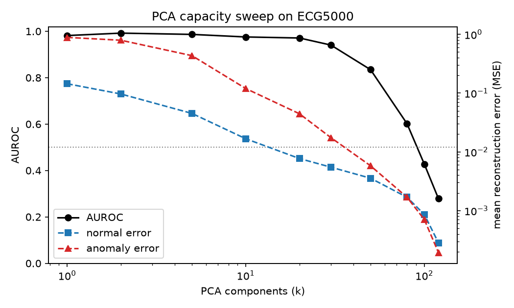
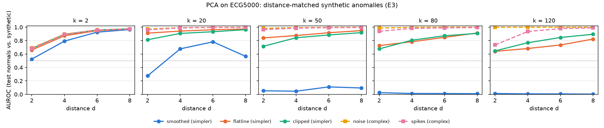
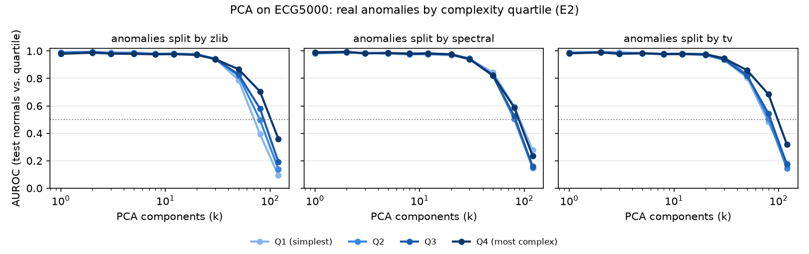

# When Reconstruction Gets Too Good

**When and why does reconstruction-based anomaly detection fail in generative models?**

A model trained only on normal data is supposed to reconstruct anomalies badly.
But as capacity grows, a model can learn to reconstruct *everything*, anomalies
included, and detection collapses — sometimes below chance. This project is a
controlled study of that failure on ECG heartbeats, comparing a linear
baseline (PCA), a VAE and a diffusion model, and asking whether what makes a
model *generative* (a KL prior, a noise schedule, a likelihood score) protects
detection as capacity grows.

## Research questions

- **RQ1 – Capacity:** How does detection (AUROC) change as model capacity grows?
- **RQ2 – Scores:** Do reconstruction error, KL and likelihood (ELBO) agree on
  which samples are anomalous?
- **RQ3 – Why it fails:** Is failure driven by capacity, or by anomalies being
  *simpler* than normal data? Tested with synthetic anomalies matched on
  distance from normal.
- **RQ4 – Label-free selection:** Without labeled anomalies, can we pick a
  capacity that detects well, using AUROC on synthetic anomalies as a proxy?

The full plan is in [PLAN.md](PLAN.md).

## Data

- **ECG5000** (primary): 5,000 heartbeats of 140 points. Class 1 = normal,
  classes 2–5 = abnormal beat types. Beats are already z-normalized per beat by
  UCR. Normal beats are split 70/15/15 (train / val / test); all anomalies go
  to test. Models are trained on normal beats only.
- **MIT-BIH Arrhythmia** (second dataset, planned): patient-wise split, raw
  amplitude.

## Experiments

| | Anomalies | Purpose |
|---|---|---|
| **E1** | real anomaly classes | capacity sweeps (RQ1, RQ2) |
| **E2** | real classes, split by measured complexity | are the *simpler* real anomalies the ones missed? (RQ3) |
| **E3** | synthetic, distance-matched: smoothed, flatline, clipped (simpler); noise, spikes (more complex) | RQ3, controlled |
| **E4** | synthetic anomalies built from validation normals | label-free capacity selection (RQ4) |

Complexity is measured three ways (`src/complexity.py`): zlib compressed size,
fraction of high-frequency energy, and total variation.

## Status

- [x] ECG5000 download and 70/15/15 split (2043 train / 437 val / 439 normal + 2081 anomalous test)
- [x] Complexity measures and distance-matched synthetic anomalies
- [x] PCA: E1, E2, E3, plus a frequency analysis of why smoothed anomalies are missed
- [x] VAE model with learned decoder variance σ_x (not trained in a sweep yet)
- [ ] VAE training script and sweeps (latent dim, β) with 5 seeds
- [ ] Diffusion model (denoiser width × noise level t)
- [ ] E4 (label-free selection) for all models
- [ ] MIT-BIH loader and reruns
- [ ] Blog post (mid-December 2026), then a conference paper

## Results so far (PCA)

**E1 – capacity collapse.** AUROC is near perfect at low capacity and falls
below chance as the number of components k grows.

| Components (k) | Normal error | Anomaly error | AUROC |
|---:|---:|---:|---:|
| 1   | 0.138  | 0.901  | 0.986 |
| 5   | 0.046  | 0.428  | 0.984 |
| 20  | 0.0077 | 0.045  | 0.974 |
| 50  | 0.0037 | 0.0057 | 0.828 |
| 80  | 0.0017 | 0.0016 | 0.554 |
| 120 | 0.0003 | 0.0002 | 0.205 |



**E3 – synthetic anomalies.** At low k only distance from normal matters. At
high k the types separate: noise becomes easier to detect while smoothed beats
fall to AUROC ≈ 0.01, at every distance. The cause (`src/frequency_check.py`):
once PCA can reconstruct any smooth shape, its error mostly measures
high-frequency jitter, which smoothed beats lack. This holds for FFT cutoffs
from bin 5 to 20.



**E2 – real anomalies.** At k ≤ 30 complexity doesn't matter. From k = 50, the
simplest quartile (by zlib) fails first and worst (AUROC 0.09 vs. 0.36 for the
most complex at k = 120), also within a single class. But every quartile falls
below 0.5, and high-frequency energy does not predict the order, so the
smoothing mechanism doesn't fully explain the real-data collapse yet.



## Repo structure

```
.
├── PLAN.md                 # full study plan and timeline
├── src/
│   ├── data.py             # ECG5000 download + 70/15/15 split
│   ├── complexity.py       # zlib, spectral, total variation, variance
│   ├── anomalies.py        # synthetic anomalies + distance matching
│   ├── evaluate.py         # reconstruction error, AUROC, paradox-curve plot
│   ├── pca_model.py        # PCA baseline: E1, E2, E3
│   ├── frequency_check.py  # why PCA misses smoothed beats
│   ├── vae.py              # MLP and conv VAEs with learned σ_x
│   ├── train.py            # train one VAE; save and load runs
│   ├── vae_experiments.py  # VAE experiments: E1, beta sweep, matched error, E3
│   └── vae_plots.py        # figures for the VAE experiments
├── scripts/
│   └── scc_ecg.sh          # job script for BU's SCC
├── results/
│   ├── figures/
│   └── metrics/            # CSVs (gitignored)
└── data/                   # downloaded and cached splits (gitignored)
```

Planned: `src/diffusion.py`, an MIT-BIH loader, and
`blog/draft.md`.

## Setup

Requires Python 3.13. On Apple Silicon, use a native arm64 Python (e.g. from
python.org) so pip installs a torch build with MPS support.

```bash
git clone https://github.com/Saniiyaa59/reconstruction-too-good.git
cd reconstruction-too-good
python3.13 -m venv .venv
.venv/bin/pip install -r requirements.txt
```

## Usage

```bash
python src/data.py                  # download ECG5000 and build the splits
python src/complexity.py            # complexity per class on the test set
python src/anomalies.py             # generate synthetic anomalies, plot examples
python src/pca_model.py             # E1: PCA capacity sweep
python src/pca_model.py --exp E2    # E2: real anomalies by complexity quartile
python src/pca_model.py --exp E3    # E3: distance-matched synthetic anomalies
python src/frequency_check.py       # frequency analysis at FFT cutoffs 5-20
python src/vae_experiments.py e1             # VAE: AUROC vs. latent size
python src/vae_experiments.py beta-sweep     # VAE: lower beta on a no-bottleneck network
python src/vae_experiments.py matched-error  # VAE: KL on vs. off at equal reconstruction error
python src/vae_experiments.py e3 RUN         # VAE: synthetic anomalies, on saved runs
```

## Background

Final project for CS599 "Deep Visual Generative Models" at Boston University.
The course deliverable is a blog post; the study will then be extended into a
conference submission.

## References

- Nalisnick et al., "Do Deep Generative Models Know What They Don't Know?" (ICLR 2019)
- Bauer, Nakajima & Müller, "Self-Supervised Training with Autoencoders for Visual Anomaly Detection" (arXiv:2206.11723)
- Yong & Brintrup, "Do Autoencoders Need a Bottleneck for Anomaly Detection?" (arXiv:2202.12637)
- Zhang et al., "DiffusionAD: Norm-guided One-step Denoising Diffusion for Anomaly Detection" (arXiv:2303.08730)
- Serrà et al., "Input Complexity and Out-of-Distribution Detection with Likelihood-based Generative Models" (ICLR 2020)

## License

MIT
